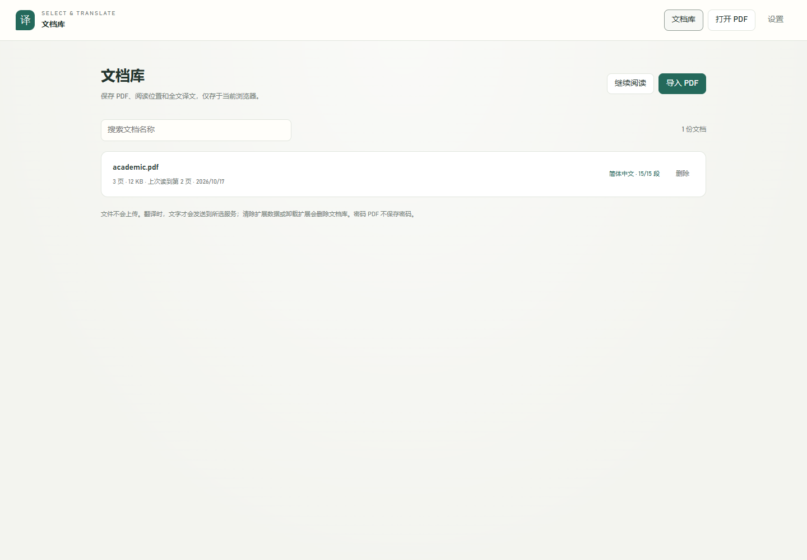
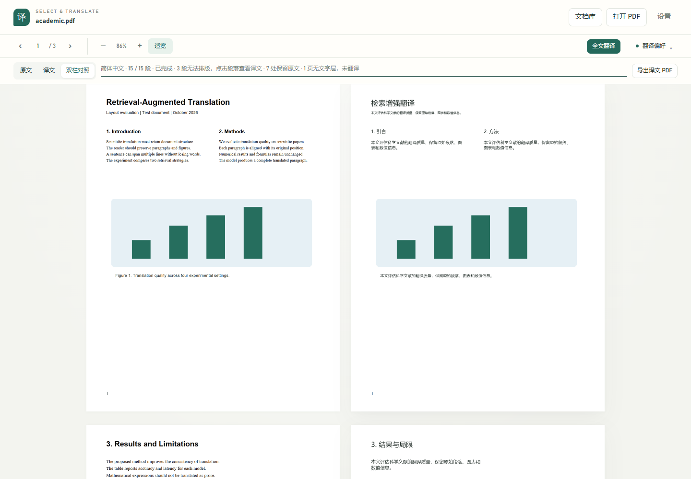

# 文献翻译器 1.3

本地 PDF 阅读、划词翻译、全文翻译和文章 AI 讨论。提供 Windows 应用与 Chrome / Edge 扩展，两者共用阅读器与翻译逻辑，数据分别保存，可通过文档库备份迁移。

## 当前状态

- 1.3 增加独立 Windows 应用、文章对话、目录、全文查找、书签、逐页笔记、备份恢复，以及跟随系统 / 浅色 / 深色主题。
- 当前本机配置的真实 DeepSeek 请求再次返回 **HTTP 401**。需要更正凭据、账户或接口配置后，才能完成真实全文翻译及多轮对话的语义验收。旧版成功样例不代表当前凭据可用。
- 受控 AI 响应只验证功能、布局和异常处理，**不证明实际模型翻译或推理质量**。真实论文参考译文测试也仅验证排版。
- 最终免安装 ZIP 中的实际 EXE 已通过 14 项原生检查，221 个源码 / 资源文件与冻结源码逐字一致。已准备本机应用目录与桌面入口；安装程序完成构建和结构检查，但未运行安装向导。交付文件与操作说明位于桌面「文献翻译器」文件夹。

## 1. 选择应用或插件

| 形式 | 适用场景 | 数据与要求 |
| --- | --- | --- |
| Windows 应用 | 独立打开本地论文，不依赖浏览器扩展 | Windows x64；自带运行时；独立文档库和设置 |
| Chrome / Edge 插件 | PDF 阅读，以及普通网页划词翻译 | 扩展开发者模式加载；数据属于当前浏览器个人资料 |

应用不设置默认浏览器或 PDF 关联。应用桌面快捷方式指向 `PaperTranslator.exe`；仓库的 `open-reader.cmd` / `open-reader.ps1` 是**插件阅读器启动器**，不是独立应用。

### Windows 应用

构建产物名称：

- 安装包：`dist/desktop/PaperTranslator-Setup-1.3.0-x64.exe`。
- 免安装 ZIP：`dist/desktop/PaperTranslator-Portable-1.3.0-x64.zip`。
- 校验值：`dist/desktop/SHA256SUMS.txt`。

安装包按当前用户安装，默认目录为 `%LOCALAPPDATA%\Programs\PaperTranslator`，不需要管理员权限。免安装 ZIP 解压后运行 `PaperTranslator/PaperTranslator.exe`；保留整个文件夹，不能只复制 EXE。

**本机运行路径限制：** 已复现当前 Electron 运行时在原 OneDrive 中文目录中启动时异常退出。请将应用本体放在**非 OneDrive 的本地英文路径**，例如当前用户的 `%LOCALAPPDATA%\Programs\PaperTranslator`。若用户目录自身含中文，请选择另一个有写入权限的英文目录。中文 PDF 文件名、中文快捷方式与中文界面无需改名。

应用尚无 Windows 代码签名，系统可能提示未知发布者。核对交付来源和 SHA-256，不要为运行软件关闭安全软件。没有内置自动更新下载，升级使用后续安装包。

点击「打开 PDF」、拖文件进窗口、把 PDF 拖到应用快捷方式，或运行：

```powershell
& "$env:LOCALAPPDATA\Programs\PaperTranslator\PaperTranslator.exe" 'C:\Papers\paper.pdf'
```

再次启动会把文件交给已有应用窗口。免安装版也使用独立用户数据目录，不把文档库放在解压目录。

### Chrome / Edge 插件

1. 解压 `pdf-translate-extension-1.3.0.zip`，保留含 `manifest.json` 的完整目录。
2. Chrome 打开 `chrome://extensions/`；Edge 使用 `edge://extensions/`。
3. 开启「开发者模式」→「加载已解压的扩展程序」，选择该目录。
4. 点击扩展图标打开阅读器，将 PDF 拖入或点击「打开 PDF」。
5. 若通过 `file:///...` 链接读取文件，在扩展详情另行启用「允许访问文件网址」；直接拖入不需要此项。

升级时保留原目录、浏览器个人资料和扩展 ID，更新后点击「重新加载」，关闭旧阅读器并重新打开。移动目录可能改变未签名扩展 ID；迁移或卸载前先备份。

Windows 插件启动器需要 PowerShell 7，默认 Chrome，不修改系统默认浏览器：

```powershell
pwsh -File .\open-reader.ps1
pwsh -File .\open-reader.ps1 -Browser Edge
```

当前自动化主要使用 Chrome 155，不将 Chrome 通过写成 Edge 完整验收通过。

## 2. 日常阅读

### 文档库与阅读工具

- 「导入 PDF」支持多选或拖入，按内容指纹去重并保存本地副本，不修改磁盘原始文件。
- 支持名称搜索、最近阅读 / 最近导入 / 名称排序、重命名、继续阅读和删除。
- 阅读位置、全文译文、书签、笔记、讨论和草稿关联到文档；再次打开无需原路径。
- 密码 PDF 保存原始加密字节，不保存密码，重新打开需再次输入。
- 删除会清除本机副本及关联记录，不删除磁盘原文件；建议先备份。
- 「目录」读取 PDF 自带大纲，支持层级与跳转；没有大纲时不伪造章节。
- 「查找」搜索文字层并显示页码、上下文和高亮，可停止长文搜索；结果或页内文字达到上限会明确提示不完整。
- 「书签」收藏当前页；「笔记」按页保存。切页不会把未保存笔记误记到下一页，记录可导出 Markdown。
- 多窗口独立笔记按修改合并；对话被另一窗口更新时暂停本窗口保存，保留本地内容供导出，不静默覆盖。

支持适合宽度、整页、缩放与页码跳转。深色主题不反转 PDF 页面和图表颜色。

### 划词翻译

自带阅读器中选中文字即可翻译；关闭「选中即译」后先显示按钮，点击才发送。「整句补全」尝试把短选区扩展为句子。卡片支持重译、复制和「问 AI」。单次选区上限 4000 字符，超长会提示，不静默截断。

Chrome / Edge 原生 PDF 阅读器不能把内部选区直接交给扩展，不保证原生阅读器的松手翻译。推荐改用本阅读器，或先复制文字，再点击插件弹窗的「翻译剪贴板内容」。普通网页划词仅由插件提供。

## 3. 配置翻译与 AI

在「设置 → 自定义 API」填写接口、模型和自己的有效 Key：

| 字段 | 示例或说明 |
| --- | --- |
| 接口地址 | `https://api.deepseek.com/v1`，通常填 `/chat/completions` 之前的部分 |
| 模型 | 服务商实际支持的名称，例如 `deepseek-chat` |
| API Key | 保存后只显示已配置状态，不回显已有 Key |
| 额外请求参数 | 可选 JSON 对象；思考模式等参数需匹配具体服务 |

支持 OpenAI 兼容 Chat Completions 接口，本地 Ollama / LM Studio 等可能不要求 Key。质量、可达性和收费取决于实际服务，不保证固定延迟或“最好”质量。

「测试翻译」固定测试所选服务，不读取缓存、不用其他引擎结果冒充成功。「测试各引擎速度」只展示当次结果，不擅自改配置。HTTP 401 应检查 Key、地址、账户及模型权限，不能算作真实翻译验收完成。

### 免费服务与文本发送范围

Google、Microsoft、有道演示接口和 MyMemory 仅用于免费翻译尝试，可能限流、改接口或不可达，不是软件托管的稳定服务，也不能用于 AI 对话。

- 划词开启「快速译文 + AI 优化」时，文字可能发送给多个免费服务和已配置 AI，再以最终 AI 结果更新。
- 自动模式可能尝试不同免费服务。不希望发给免费服务时，选择「自定义 API」并关闭快速模式。
- 全文配置 AI 后只使用该 AI 的最终结果，不启用免费首译竞速；鉴权失败不偷偷换服务。
- 对话只用已配置 AI，不用翻译接口伪装回答。失败不自动重试；手动「重试」会新发请求，可能重新计费。

高级 JSON 不允许覆盖 `model`、`messages` 或 `stream`。更换模型、思考参数或输出上限前，先测试短段落。

### 本地配置文件

插件可选用根目录 `config.local.json`，格式参考 `config.local.example.json`。它是**明文私密文件**，排除在版本控制与分发包之外：

```json
{
  "baseUrl": "https://api.deepseek.com/v1",
  "model": "deepseek-chat",
  "apiKey": "YOUR_API_KEY"
}
```

浏览器已保存 Key 优先；未保存且接口匹配时才使用本地兜底，不自动把文件里的 Key 写回浏览器。应用安装包不自动读取源码目录此文件；仅源码开发模式显式传入 `--developer-config=绝对路径` 才可加载。

## 4. 全文翻译与导出

1. 点击「全文翻译」，确认语言、服务、费用与排版说明后开始。
2. 查看完成 / 失败 / 保留原文提示，以「原文 / 译文 / 双栏对照」核对；点击译文区域查看完整段落。
3. 支持暂停、继续、失败重试和段落检查点。同一文档及配置跨窗口互斥；已发送 API 请求仍可能计费。
4. 保存异常会提示并提供重试，离开未保存任务时警告。可随时用「导出段落对照」保存 Markdown，部分完成也能保留文字结果。
5. 可翻译段落全部完成后导出译文 PDF，原文件不修改。

**近似排版，不是出版级原生重排。** 按文字层几何位置识别分栏、段落，保留页面尺寸、页数和图表。独立公式、参考文献书目、细小图内文字、扫描页、旋转或竖排等区域可能保留原文。译文放不下或会覆盖其他文字时，不截断或无限缩小，而是保留原文并提供段落对照。

**译文 PDF 是高清图像型 PDF。** 导出后无法再次划词、全文搜索，也不保留原来的交互表单、链接与数字签名结构。需可复制文字时用段落 Markdown 或阅读器。彩色背景、复杂表格、跨页混排和嵌入图片文字需人工核对。

## 5. 结合文章讨论

点击「AI 对话」，或选择原文后在卡片点「问 AI」。快捷问题只填入输入框，不自动发送，可先修改。

- 本机提取分栏段落，根据问题、当前页、选中内容及最近问题检索；不默认发送整个 PDF。
- 点击回答的页码回到原文；展开「本轮参考原文」可查看实际发送的片段，不把引用存在当成结论正确。
- 提示模型区分「依据原文」与「分析/推断」，证据不足时说明。文献中的指令性文本只作参考，不执行代码或工具。
- 可停止流式生成；对话、草稿和选中引用按文档保存。新对话需确认清空，历史可导出 Markdown。
- 页码是 PDF 文件页序，可能不同于印刷页码。回答、引文和统计数字仍须核对。

当前为本地关键词、主题及章节启发式检索，不是向量知识库。每轮最多 12 段、约 18000 字符；索引达到前 1000 页或约 350 万字符时提示范围限制。没有图像理解或 OCR，不能声称完整理解全部图表。

## 6. 备份、迁移与保存异常

文档库「备份」可选全部或单篇，包含 PDF、阅读位置、译文、书签、笔记、对话和草稿。「恢复备份」完整校验后合并，较新本机记录优先，不用旧备份无条件覆盖。

- 应用、插件、不同浏览器或个人资料间通过备份迁移，不自动同步或上传云端。
- 单份备份上限 512 MB，文字记录上限 32 MB，超出请按单篇分批备份。
- **ZIP 未加密。** 含原文、笔记和对话，不主动包含 API 设置与 Key；自行写进聊天或笔记的敏感信息仍会进入备份。
- 恢复仅接受支持的备份格式；正在写入或有未保存草稿时需先处理，不把任意 ZIP 当文档库。
- 单独导出笔记、讨论、段落 Markdown 可应急保存，但不是完整文档库备份。

保存失败或冲突时先保留窗口，重试或导出，不要立即清数据或重装。正常关闭有保存流程；强制结束、崩溃或断电仍可能丢失最后尚未落盘的修改。

## 7. 数据与安全

| 内容 | Windows 应用 | 插件 |
| --- | --- | --- |
| 文档和记录 | `%APPDATA%\文献翻译器` 下的用户数据 | 当前扩展来源的 IndexedDB |
| 普通设置 | 用户数据内 `preferences.json` | `chrome.storage.local` |
| API Key | Electron `safeStorage` 使用 Windows 系统加密 / DPAPI；无法加密则拒绝保存，不回退明文 | 浏览器扩展本地存储或可选明文文件；**不是应用版 DPAPI 存储** |
| 升级与卸载 | 升级不主动清库；卸载默认保留用户数据，仍建议先备份 | 卸载、清存储或丢失个人资料可能删除记录 |

应用 Key 解密依赖原 Windows 用户环境，复制设置文件不能代替跨设备迁移凭据。两端不回显已有 Key，不将其写入分发包或文档库备份。

应用阅读窗口禁用 Node，启用上下文隔离及沙箱，仅允许明确业务 IPC 与资源路径。外部网页 / 邮件链接需确认后交系统应用，不允许文献直接读取任意磁盘文件、执行脚本或任意开窗口。插件需要网站访问、标签页、存储、脚本与剪贴板等权限，可在浏览器限制允许的网站。

pdf.js、字体及 CMaps 本地打包，无遥测、云同步或运行时远程代码。离线可阅读、搜索、记笔记和备份；翻译、对话、远程下载需要网络。服务端留存与收费以实际服务商政策为准。

## 8. 常用快捷键

| 快捷键 | 操作 |
| --- | --- |
| `Ctrl+O` | 打开 PDF |
| `Ctrl+F` | 查找；查找框 Enter / Shift+Enter 切换结果 |
| `Ctrl+D` | 添加 / 取消当前页书签 |
| `Ctrl+0` | 适合宽度 |
| `Ctrl++` / `Ctrl+-`、`Ctrl+滚轮` | 缩放 |
| `PageUp` / `PageDown`、左右方向键 | 翻页，输入状态不拦截 |
| `Ctrl+Home` / `Ctrl+End` | 首页 / 尾页 |
| `Esc` | 关闭卡片或面板 |
| 对话框 `Enter` / `Shift+Enter` | 发送 / 换行 |
| 插件 `Alt+Z` / `Alt+X` | 翻译选区或剪贴板 / 用插件阅读器打开 |

插件快捷键冲突可在 `chrome://extensions/shortcuts` 或 `edge://extensions/shortcuts` 修改。常用翻译偏好在阅读工具栏，外观、API 和高级参数在设置页。

## 9. 常见问题与限制

- **仍进入 Edge：** 旧快捷方式可能是插件启动器或 PDF 关联。使用应用快捷方式或 `PaperTranslator.exe`，无需改默认浏览器。
- **应用启动即退出：** 检查是否仍在 OneDrive / 中文运行路径，或只复制了单个 EXE，按安装说明处理。
- **扫描件无文字：** 本版不含 OCR，需先用其他工具生成可靠文字层再导入。
- **401/403/429：** 检查凭据、权限、限流与余额；受控测试通过不意味着个人账户可用。
- **网络 PDF 打不开：** 可能需要登录或存在下载 / 跨域限制；先保存本地再导入。
- **大文档：** 单份 PDF 导入上限 200 MB，高清导出较耗内存；千页、超大尺寸和复杂混排未全面验收。
- **导出不能选词：** 图像型导出的限制，不是原始 PDF 被修改。
- **找不到旧记录：** 确认应用 / 插件、浏览器个人资料及扩展 ID 是否切换，这些存储不共享，可用备份迁移。

## 10. 开发、构建与验证

### 环境

本机使用 Node.js 24、Python 3、PowerShell 7、Chrome 155。桌面依赖锁定在根目录 `package-lock.json`，浏览器测试依赖位于 `dev/`。PowerShell 脚本使用 7，避免 5.1 的 UTF-8 中文编码问题。

```powershell
npm ci
pnpm --dir dev install --frozen-lockfile
```

浏览器测试使用隔离扩展副本和个人资料，不移动真实 Key 文件，可用 `BROWSER_PATH` 指定 Chromium。不要并发执行会修改同名截图或访问真实服务的脚本。

### 构建

```powershell
npm run desktop:dir
npm run desktop:build
node dev/test/desktop-package.mjs
python dev/tools/package.py
```

`desktop:build` 输出安装包与免安装 ZIP；`desktop-package.mjs` 校验当前源码、原生 EXE 和包结构。`desktop:portable` 仅生成免安装产物。插件 ZIP 输出到仓库上一级。构建不会自动公开发布或签名。

`npm run desktop` 用于源码启动，也需满足当前机器的英文、非 OneDrive 运行路径要求。桌面测试复制运行时到隔离英文目录、使用独立用户数据，避免污染真实文档库。

### 测试入口

```powershell
# 确定性单元测试，不需真实 Key
node --test dev/test/unit.mjs dev/test/layout.mjs dev/test/backup-unit.mjs dev/test/reader-unit.mjs dev/test/chat.mjs dev/test/desktop-unit.mjs

# 浏览器集成与异常处理
node dev/test/regression.mjs
node dev/test/advanced.mjs
node dev/test/usability.mjs
node dev/test/reader-browser.mjs
node dev/test/reader-backup-browser.mjs
node dev/test/chat-browser.mjs
node dev/test/chat-storage-browser.mjs
node dev/test/document-storage-browser.mjs
node dev/test/smoke.mjs

# 当前构建的真实桌面 EXE，受控 API
node dev/test/desktop.mjs
```

`npm --prefix dev test` 运行 1.3 单元与浏览器回归；冒烟、真实论文专项和实际桌面 EXE 需按上方命令另行运行。各套件通过状态、待复验项与历史现场见 [自查记录](docs/AUDIT-2026-10-17.md)。远端 CI 只是轻量检查子集，不代替本机安装包验收。

真实论文排版和真实模型链路分开验证，原文件不随分发包发布：

```powershell
$env:PDF_REPRO_FILE = 'C:\Papers\s41467-020-18353-4.pdf'
node dev/test/nature.mjs

# 实际调用配置服务，需要有效凭据，可能产生费用
$env:REAL_TRANSLATION_PDF = $env:PDF_REPRO_FILE
$env:REAL_PREVIEW_PAGE = '2'
node dev/test/full-document-real.mjs
```

`nature.mjs` 用经核对的参考中文验排版；`full-document-real.mjs` 才调用真实模型。失败不记作语义通过。截图默认在忽略目录 `dev/test/artifacts/`，不会自动替换预览。

### 代码位置

| 路径 | 职责 |
| --- | --- |
| `src/viewer.*`、`src/reader-tools.*` | 阅读、目录、查找、书签与笔记 |
| `src/background.js` | 共享设置、翻译与对话传输 |
| `src/document-tools.mjs`、`src/pdf-layout.mjs` | 文档库、全文任务、近似原位排版 |
| `src/article-chat.*`、`src/chat-context.mjs` | 讨论、检索、引用和会话保存 |
| `src/library.mjs`、`src/library-backup.mjs` | IndexedDB、备份与恢复校验 |
| `desktop/`、`src/desktop-platform.js` | 原生应用、安全存储和受限桥接 |
| `src/ui.css`、`src/appearance.js` | 共享外观与主题 |
| `vendor/` | 本地 pdf.js、字体与 CMaps |
| `dev/test/` | 单元、浏览器和桌面验收 |

## 预览与许可证





以上为 1.2 阶段受控响应截图，只说明界面，不是 1.3 最终安装验收或真实翻译质量证明。`docs/screenshot.png` 是更早版本短句样例，也不能证明当前凭据可用。

项目采用 [MIT](LICENSE)。pdf.js 为 Apache-2.0；`vendor/standard_fonts/` 各字体保留对应许可证。桌面第三方声明见 [desktop/LICENSES.txt](desktop/LICENSES.txt)，分发时一并保留。
