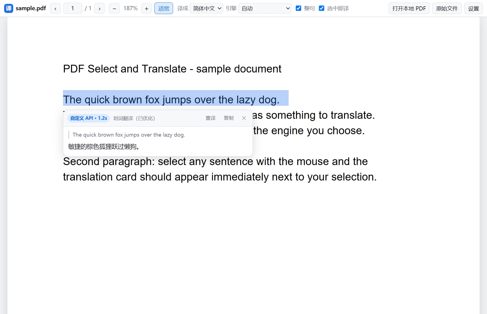

# PDF 划词翻译 · Select & Translate

一个 Chrome / Edge（Manifest V3）扩展：**在 PDF 里选中句子，松手立刻出译文。**

- 自带 PDF 阅读器（本地打包 pdf.js，含 CJK CMaps）→ 真正的「选中即翻译」，可自动把片段补全成整句
- 同时支持普通网页划词翻译（同一套引擎与设置）
- 免费引擎开箱可用：Google / Microsoft / 有道 / MyMemory，可自动依次兜底
- 可选自定义 OpenAI 兼容 API（DeepSeek、OpenAI、硅基流动、Ollama、LM Studio…），质量最好
- **先秒出、再升级**：约 0.2 秒先给一版免费译文，大模型的译文边生成边替换（流式）
- 全部依赖本地打包，无远程代码、无统计上报；译文只在本地缓存最近 500 条



---

## 1. 安装（开发者模式加载）

```bash
git clone https://github.com/danjiao666-creator/pdf-select-translate.git
```

或者直接下载本仓库的 zip 解压。

1. 打开 `chrome://extensions/`（Edge 为 `edge://extensions/`）
2. 打开右上角 **开发者模式**
3. 点击 **加载已解压的扩展程序**，选择仓库根目录（含 `manifest.json` 的那一层）
4. 建议顺手设置快捷键：`chrome://extensions/shortcuts`
   （默认 `Alt+Z` 翻译选中，`Alt+X` 用阅读器打开 PDF）

> 想翻译**本地文件**（`file:///…`）时，需要在扩展详情里额外打开 **「允许访问文件网址」**；
> 或者直接把 PDF 拖进扩展阅读器窗口（推荐，不受任何跨域限制）。

> Windows 用户还可以双击仓库里的 `open-reader.cmd` 直接打开自带阅读器（支持把 PDF 拖到它上面）。

## 2. 怎么用

### 打开「自带阅读器」的几种方式

> 自带阅读器不是一个独立程序，而是扩展内的一个页面：`chrome-extension://<扩展ID>/src/viewer.html`。
> 仓库里的 `open-reader.cmd` / `open-reader.ps1` 会按目录路径自动算出扩展 ID 并打开它。

1. **点扩展图标** →「用翻译阅读器打开（本标签）」
2. **Windows**：双击 `open-reader.cmd`（也可以把 PDF 文件**拖到它上面**直接打开）
3. 在设置里打开 **「自动打开 .pdf 链接」** 后，点 PDF 链接会自动进阅读器

### 推荐流程：用自带阅读器（真正的「选中即翻译」）

1. 用上面任一方式打开阅读器
2. 用鼠标划选任意文字，**松手立即出译文卡片**
   - 只选了几个词也没关系：勾选 **整句** 会自动把选区扩展到完整句子（按句读与行边界）
   - 卡片上可以 **重译 / 复制 / 关闭**，按 `Esc` 关闭
3. 本地文件：把 PDF **拖进阅读器窗口**，或点 **「打开本地 PDF」**
4. 工具栏可选择 **译成语言 / 引擎 / 缩放**；`Ctrl+滚轮` 缩放，`PgUp/PgDn` 翻页

### Chrome / Edge 内置 PDF 阅读器（有先天限制，见第 5 节）

内置阅读器由浏览器插件渲染，扩展**拿不到选区、也收不到鼠标事件**，因此只能这样触发：

| 方式 | 操作 |
| --- | --- |
| 剪贴板 | 选中文字 → `Ctrl+C` → 点扩展图标 → **「翻译剪贴板内容」** |
| 快捷键 | 选中文字 → `Ctrl+C` → 按 `Alt+Z`（在 PDF 页面里也是读剪贴板） |
| 自动监听 | 设置里打开 **「内置阅读器：Ctrl+C 后自动翻译」**，之后复制即出卡片 |
| 右键菜单 | 内置阅读器**不会**显示扩展的右键菜单项（浏览器限制） |

### 普通网页

选中文字即出译文（可在设置里改成「先显示『译』小按钮」）。

## 3. 翻译引擎

| 引擎 | 需要 Key | 说明 |
| --- | --- | --- |
| 自动（默认） | 否 | 配了自定义 API 就先用它，否则在有道 / MyMemory / Google / Microsoft 之间按实测速度竞速 |
| Google | 否 | 质量好，但部分网络（如中国大陆直连）不可达，且偶发 HTTP 429 |
| Microsoft | 否 | 走 `edge.microsoft.com` 取 token + `api-edge` 接口，部分地区会 404 |
| 有道（演示接口） | 否 | 非官方演示接口，国内网络通常可达，速度最快（实测 70~360ms） |
| MyMemory | 否 | 免费兜底，单次约 500 字节（扩展会自动分句分片并并发请求） |
| 自定义 API | 是 | OpenAI 兼容 `/chat/completions`，推荐 DeepSeek，质量与稳定性最好 |

**如果翻译总是失败**：说明当前网络到免费接口不通 → 在设置页配置自定义 API，例如
接口地址 `https://api.deepseek.com/v1`、模型 `deepseek-chat`、你的 API Key。
设置页有 **「测试翻译」** 按钮可立即验证。

### 3.1 速度

**默认行为：先秒出、再升级。** 划词后先用免费引擎给一版译文（约 0.2 秒），
随后自定义大模型的译文会**边生成边替换**（角标显示「AI 生成中… n 字」→ 完成后变成引擎名）。
本机实测（真实 DeepSeek Key，全新配置）：

```
第一段（有道，秒出）  : 363 ms    ← 几乎立刻看到译文
大模型流式首字        : 1777 ms   ← 开始逐字替换
完成（deepseek-chat） : 1873 ms
```

其它机制：

| 情况 | 行为 |
| --- | --- |
| 「先秒出」阶段 | 所有免费引擎**同时发**，谁快用谁 |
| 大模型输出 | **流式**（SSE）逐字显示；网关不支持流式会自动退回一次性请求 |
| 每个引擎的超时 | 免费接口 5~6 秒、自定义 API 120 秒 |
| 被墙 / 超时的引擎 | 记入 **10 分钟冷却**，不再反复去撞 |
| 引擎实测耗时 | 记录滑动平均，auto 时**最快的排最前** |
| 同一句话 | 结果本地缓存（含升级后的高质量版本），重复划选 0ms |
| 显式选了「自定义 API」 | 同样享受「先秒出」——升级目标本来就是它 |

各引擎实测（本机、中国大陆网络）：Google ❌ 429、Microsoft ❌ 404、
有道 ✅ 70~360ms、MyMemory ✅ 500~1000ms、`deepseek-chat` ✅ 首字 0.4~1.8s。

> 同一批文本、同一把 Key、同一网络下的首字时间对比：
> `deepseek-chat` **382 ms** ｜ `deepseek-flash` **2038~3862 ms**（不推荐）。
> 设置页在填了 `flash` / `reasoner` 时会直接给出警告。

设置页还有 **「⚡ 测速并选用最快引擎」**：并发测一遍所有引擎，把最快的固定下来。

### 3.2 关掉「思考」让它更快

带思考的模型（`deepseek-reasoner`、部分 Qwen/GLM 默认开启思考）会先输出一大段推理再翻译。三种处理：

1. **换模型**（最有效）：DeepSeek 用 `deepseek-chat` 而不是 `deepseek-reasoner`
2. **设置页 → 思考模式** 里选预设，会自动填好「额外请求参数」：
   - 关闭思考 · 通义/Qwen 等 → `{"enable_thinking": false}`
   - 思考强度最低 · OpenAI 兼容 → `{"reasoning_effort": "low"}`
   - 关闭思考 · 部分网关 → `{"thinking": {"type": "disabled"}}`
3. 也可以手写任意 JSON（会合并进 `/chat/completions` 请求体）

### 3.3 把 Key 放在扩展目录（可选）

扩展目录下可以放一个 **`config.local.json`**（本机私密文件，**不会**被打进分发包）：

```json
{ "baseUrl": "https://api.deepseek.com/v1", "model": "deepseek-chat", "apiKey": "sk-..." }
```

设置页里的 API Key 优先级更高；留空时就用这个文件里的。模板见 `config.local.example.json`。

## 4. 设置项

| 设置 | 说明 |
| --- | --- |
| 目标语言 / 源语言 | 支持中（简/繁）、英、日、韩、法、德、西、俄等 |
| 引擎 | 见上表 |
| 选中即译 | 关闭后改为「先显示『译』按钮，点击才翻译」 |
| 先秒出、再升级 | 免费引擎先出译文，随后用自定义 API 的结果自动替换 |
| 整句 | 划选片段自动扩展到完整句子 |
| 自动打开 .pdf 链接 | 点击/跳转 `.pdf` 链接时自动换到自带阅读器（默认关闭） |
| 内置阅读器剪贴板监听 | 在内置阅读器里 `Ctrl+C` 后自动翻译（默认关闭） |
| 卡片字号 | 译文卡片字体大小 |
| 自定义 API | Base URL / API Key / 模型 / 思考模式 / 额外请求参数 / 系统提示词 |
| ⚡ 测速并选用最快引擎 | 并发测一遍所有引擎，把最快的固定下来 |

## 5. 为什么需要自带阅读器（技术说明）

浏览器的内置 PDF 阅读器把 PDF 交给内部插件（PDFium）渲染：

- 页面 DOM 里没有 PDF 文字，`window.getSelection()` 恒为空
- 插件里的鼠标 / 选区事件不会冒泡到网页，`mouseup` / `selectionchange` 都收不到
- 内置阅读器显示自己的原生右键菜单，扩展的 `contextMenus` 项不会出现
- 唯一可靠到达的入口是 `chrome.commands` 快捷键（命令会送到扩展的 service worker）

所以本扩展的做法是：

1. **自带阅读器**：用本地 pdf.js 渲染 canvas，并自己铺一层透明文字层（span 绝对定位 + `scaleX` 校正），
   于是浏览器原生选区 / `Range` 作用在 PDF 文字上 → 划词、整句扩展、卡片都成为可能。
2. **内置阅读器兜底**：快捷键 / 弹窗按钮 / 剪贴板监听，把用户已复制的文本读回来翻译。

## 6. 目录结构

```
pdf-select-translate/           ← 仓库根目录 = 可直接「加载已解压的扩展程序」的目录
├── manifest.json               # MV3 清单（权限、命令、内容脚本）
├── open-reader.cmd / .ps1      # Windows：按目录路径算出扩展 ID 并打开自带阅读器
├── icons/                      # 图标（含快捷方式用的 icon.ico）
├── src/
│   ├── background.js           # service worker：引擎调度、超时/冷却/竞速、流式、右键菜单、快捷键
│   ├── content.js              # 内容脚本：普通网页划词 + 内置阅读器兜底 + 剪贴板监听
│   ├── viewer.html/.css/.js    # 自带 pdf.js 阅读器（文字层、整句扩展、译文卡片、流式显示）
│   ├── popup.html/.css/.js     # 工具栏弹窗：打开阅读器、剪贴板翻译、快捷设置
│   └── options.html/.css/.js   # 设置页：引擎、语言、自定义 API、思考模式、测速
├── vendor/                     # 本地打包的 pdf.js（worker、cmaps、standard_fonts）
├── docs/screenshot.png         # README 截图
├── config.local.example.json   # 本地 Key 文件模板（真正的 config.local.json 已被 gitignore）
├── dev/                        # 开发 / 测试脚手架（不参与扩展加载）
└── .github/workflows/ci.yml    # 语法检查 + 清单校验 + 防止 Key 误提交
```

数据与隐私：所有翻译请求从扩展后台发出；只在本地缓存最近 500 条译文；除所选翻译引擎外不向任何服务器发送数据。

## 7. 已知限制

- 内置 PDF 阅读器无法「选中即翻译」（浏览器架构限制，见第 5 节）
- 扫描版 PDF（纯图片、没有文字层）无法划词 —— 需要 OCR，不在本扩展范围内
- 加密 PDF 会弹出密码输入框；打不开的链接（需要登录 / 拒绝跨域）会提示改用本地文件
- 免费接口可能限流；追求稳定请在设置里配置自定义 API

## 8. 开发与测试

```bash
cd dev
pnpm install                 # 只装 puppeteer-core（约 37MB）
node test/smoke.mjs          # 端到端：17 项断言，真实 Edge + 未打包扩展 + mock 大模型
node test/screenshot.mjs     # 重新生成 docs/screenshot.png
node test/local-config.mjs   # 需要 config.local.json（真实 Key），验证「秒出 + 升级」
```

测试覆盖：扩展能加载、快捷键注册、pdf.js 文字层、整句扩展、划词出卡片、
**先秒出 + 大模型流式替换**、普通网页划词、`.pdf` 链接自动跳转、弹窗剪贴板链路、无未捕获脚本错误。

开发时踩过的坑（都已在代码里规避）：

- **Windows PowerShell 5.1 读没有 BOM 的 UTF-8 `.ps1`** 会按 ANSI 解码 → 中文乱码 + 语法错
- **PS 5.1 抓外部程序输出按 ANSI 解码** → 中文被写坏（本项目 README 就这样坏过一次）
- **PS 5.1 把带双引号的参数传给原生 exe 时会吞引号** → `node -e` / `curl -d` 的 JSON 直接失效
- 所以仓库里的 `.ps1` 工具一律 `#Requires -Version 7.0`，请用 PowerShell 7 跑
- pdf.js 的文字层是很多独立 span，直接拼接会出现单词粘连 → 见 `viewer.js` 的 `buildLayerModel()`
- 扩展 ID 由**目录绝对路径**决定，所以 `open-reader` 是运行时算出来的

打包发布：

```bash
python dev/tools/package.py    # 生成 <上级目录>/pdf-select-translate-<version>.zip
python dev/tools/make_icons.py # 重新生成图标（需要 Pillow）
```

## 9. 许可证与致谢

本项目以 **MIT** 许可证开源，见 [LICENSE](LICENSE)。

内置的第三方资源保留各自许可证：

- [pdf.js](https://github.com/mozilla/pdf.js)（`vendor/pdf.min.mjs`、`pdf.worker.min.mjs`、`cmaps/`）— Apache-2.0，Mozilla
- `vendor/standard_fonts/` — Liberation 字体（SIL OFL）与 Foxit 字体，见目录下的 `LICENSE_*` 文件

发布到浏览器扩展商店时请一并保留这些许可证文件。
